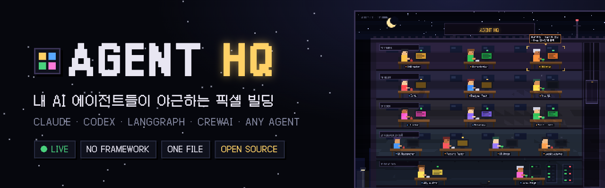
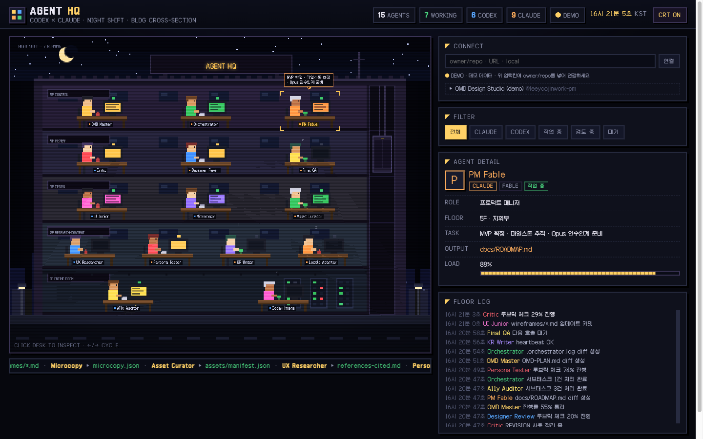

<h1 align="center">
  <a href="https://yoojin-aimaker.github.io/agent-hq/">
    
  </a>
</h1>

<h3 align="center">AI 에이전트를 숫자표가 아니라, 일하는 사람들이 있는 빌딩으로 본다</h3>

<div align="center">

[](https://yoojin-aimaker.github.io/agent-hq/)
[](https://github.com/yoojin-aimaker/agent-hq/releases)
[](https://github.com/yoojin-aimaker/agent-hq/stargazers)
[](LICENSE)
[](#how-it-works)
[](https://www.instagram.com/lilcherry.ai.maker/)

</div>

<div align="center">
<a href="https://yoojin-aimaker.github.io/agent-hq/">🏢 라이브 데모</a> •
<a href="docs/CONNECT.md">🔌 연결 가이드</a> •
<a href="https://www.instagram.com/lilcherry.ai.maker/">📸 Instagram</a> •
<a href="https://github.com/yoojin-aimaker/agent-hq/discussions">💬 Discussions</a> •
<a href="CONTRIBUTING.md">🤝 Contributing</a> •
<a href="CHANGELOG.md">📋 Changelog</a>
</div>

<br/>

**Agent HQ**는 내가 만든 AI 에이전트들을 야간 빌딩 단면도 속 픽셀 캐릭터로 보여주는 관제실입니다.
에이전트가 일을 시작하면 그 책상 모니터에 불이 들어오고, 끝나면 꺼집니다. 누가 누구에게 일을 넘겼는지는 층 로그에 쌓입니다.

Claude Code, Codex, LangGraph, CrewAI, AutoGen, 직접 만든 파이프라인 등 **무엇으로 만든 에이전트든** 연결할 수 있습니다.
필요한 건 상태를 적은 JSON 파일 하나(`agent-hq.json`)와 Node 18뿐입니다. 설치할 패키지도, 서버 비용도 없습니다.

<p align="center">
  
</p>

## 기능

- **에이전트 하나 = 책상 하나** — 같은 팀끼리 같은 층에 자동 배치, 사람이 늘면 층도 늘어남
- **실시간 상태** — 작업 중이면 타이핑하고 모니터가 깜빡이고, 검토 중이면 고개를 끄덕이고, 대기 중이면 졸음
- **자동 감쇠** — 보고가 끊긴 에이전트는 5분 뒤 '검토 중', 30분 뒤 '대기'로 저절로 내려감
- **어떤 프레임워크든** — CLI 한 줄, HTTP POST 한 번, Python 한 줄로 상태 보고
- **Claude Code 자동 감지** — `~/.claude/agents`를 스캔하고, 실제로 서브에이전트를 호출한 기록을 읽어 불을 켬
- **GitHub로 공유** — 내 리포에 `agent-hq.json`을 올리면 `?gh=내아이디/리포` 주소로 누구나 내 빌딩을 봄
- **로비** — `registry/`에 PR 하나로 내 빌딩을 공개 목록에 등록 (GitHub Actions가 자동 검증)
- **픽셀 감성 유지** — 384×288 저해상도 캔버스를 3배 확대, 11fps, 엘리베이터·네온·유성·고양이

## 시작하기

### 1분 체험 — 데모 보기

**https://yoojin-aimaker.github.io/agent-hq/** 를 열면 에이전트 15명이 일하는 데모 빌딩이 보입니다.

### 내 에이전트 연결하기

```bash
curl -O https://raw.githubusercontent.com/yoojin-aimaker/agent-hq/main/hq.mjs   # 커넥터 (파일 하나)

node hq.mjs init --name "MY AGENT HQ"      # 빈 빌딩 만들기
node hq.mjs scan                           # (선택) Claude Code / Codex 에이전트 자동 등록
node hq.mjs serve                          # → http://127.0.0.1:4173 에서 내 빌딩 보기
```

에이전트 쪽에서는 일을 시작하고 끝낼 때 한 줄씩 보고하면 됩니다.

```bash
node hq.mjs report writer --status active --task "2장 초안 작성" --team Content --origin CrewAI
```

```python
from agent_hq import HQ            # sdk/python/agent_hq.py — 표준 라이브러리만 사용
hq = HQ(origin="LangGraph")

with hq.working("researcher", task="경쟁사 조사", team="Research"):
    run_research()                 # 시작하면 불이 켜지고, 끝나면 꺼짐
```

### 다른 사람에게 보여주기

```bash
node hq.mjs push 내아이디/my-agents --watch 60
# → https://yoojin-aimaker.github.io/agent-hq/?gh=내아이디/my-agents
```

자세한 방법과 문제 해결은 **[연결 가이드](docs/CONNECT.md)** 에 있습니다.

## 보는 방법

| 주소 | 무엇이 보이나 |
|---|---|
| `/agent-hq/` | 데모 빌딩 |
| `http://127.0.0.1:4173` | 내 PC에서 실시간 (`hq.mjs serve`) |
| `/agent-hq/?gh=owner/repo` | 그 리포의 `agent-hq.json` (30초마다 갱신) |
| `/agent-hq/?gh=owner/repo@branch:path/file.json` | 브랜치·경로 지정 |
| `/agent-hq/?src=https://…/agent-hq.json` | CORS가 열린 아무 주소 |

## How it works

```
내 에이전트들 ──report──▶ agent-hq.json ──┬─ hq.mjs serve ──▶ http://127.0.0.1:4173     (실시간)
                                          └─ hq.mjs push  ──▶ 내 GitHub 리포 ──▶ ?gh=me/repo (공유)
                                                                    └─ registry/ PR ──▶ 로비
```

- **뷰어** `index.html` — 프레임워크 없는 단일 파일. 외부 데이터는 길이·형식을 검증하고 HTML 이스케이프한 뒤에만 그림
- **커넥터** `hq.mjs` — 의존성 0, 단일 파일. `init` `scan` `report` `serve` `push` `validate`
- **데이터 형식** — [`schema/agent-hq.schema.json`](schema/agent-hq.schema.json) (v1)
- **로컬 서버 보안** — `127.0.0.1`에만 열리고, 뷰어 주소와 localhost에서 온 요청만 받음. `--token` 옵션으로 보고 요청에 인증 추가
- **공개 범위** — `push`는 로컬 파일 경로를 지우고 올립니다. `task` 문구와 이벤트는 공개되니 비공개 정보는 넣지 마세요

## 로드맵

- [x] 픽셀 빌딩 단면 씬, 애니메이션, 상세 패널, 필터, 로그
- [x] Claude Code / Codex 에이전트 스캔, 실시간 상태
- [x] 누구나 연결 — 커넥터, GitHub 공유, 로비, Python SDK
- [ ] Claude Code hook으로 보고 자동화 (명령 없이 실행만 하면 불이 켜짐)
- [ ] 모바일 세로 전용 레이아웃
- [ ] 사운드 (타이핑음, 엘리베이터 딩)
- [ ] 주간 활동 히트맵 리포트

세부 진행 상황은 [docs/ROADMAP.md](docs/ROADMAP.md)에 있습니다.

## 파일 구성

| 경로 | 역할 |
|---|---|
| `index.html` | 뷰어 (HTML+CSS+JS 단일 파일) |
| `hq.mjs` | 커넥터 CLI |
| `sdk/python/agent_hq.py` | Python 보고 클라이언트 |
| `schema/` | 데이터 형식 |
| `registry/` | 로비 등록 파일, Actions가 만드는 `index.json` |
| `examples/` | 데모 빌딩 데이터 |
| `docs/` | 연결 가이드, 로드맵, 설계 문서 |

## 함께 만들기

버그 제보, 아이디어, 내 빌딩 자랑 모두 환영합니다.
[Issues](https://github.com/yoojin-aimaker/agent-hq/issues) · [Discussions](https://github.com/yoojin-aimaker/agent-hq/discussions) · [CONTRIBUTING.md](CONTRIBUTING.md)

## 만든 사람

**Yujin Lee** — AI로 일하는 방식을 만들고 가르칩니다.
📸 Instagram [@lilcherry.ai.maker](https://www.instagram.com/lilcherry.ai.maker/) · 🐙 GitHub [@yoojin-aimaker](https://github.com/yoojin-aimaker)

## 라이선스

[MIT](LICENSE) © 2026 Yujin Lee

픽셀 폰트: [Galmuri](https://github.com/quiple/galmuri) (SIL Open Font License 1.1)
